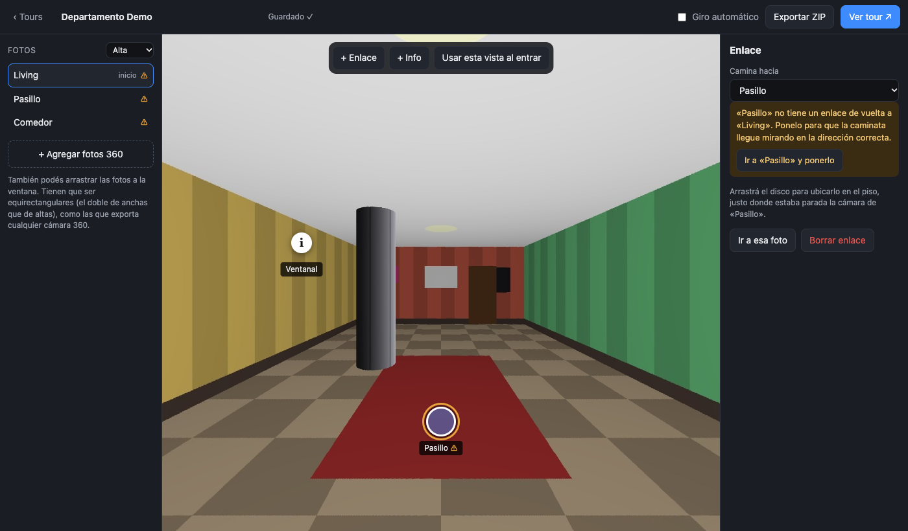
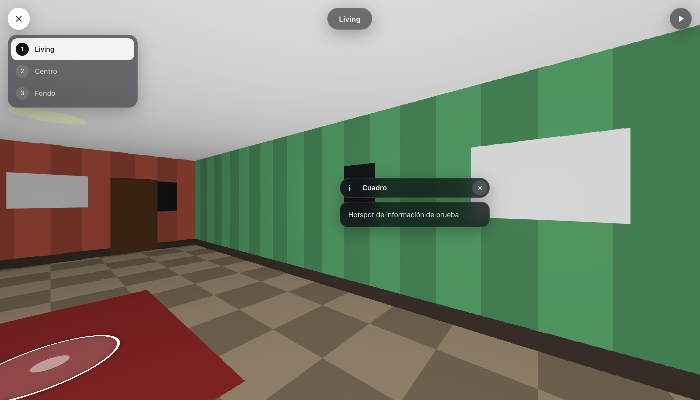
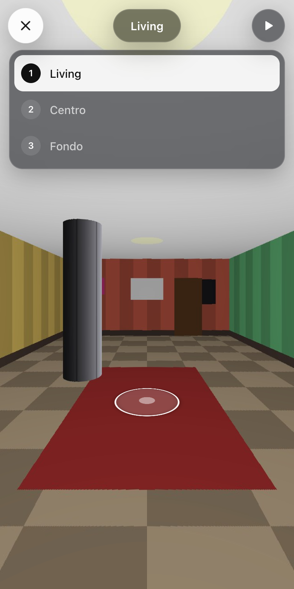

# Marzipano by Santiago Lamot

Herramienta para crear **recorridos virtuales 360°** con fotos propias, con una
transición **"caminar" estilo Matterport** entre fotos, un **editor visual** que
funciona sin internet y **exportación a ZIP** con el mismo formato que el
[Marzipano Tool](https://www.marzipano.net/tool/).

Está basada en [Marzipano](https://github.com/google/marzipano) de Google
(Apache 2.0), con un motor modificado y herramientas nuevas alrededor.



---

## Qué trae

| | |
|---|---|
| **Transición caminar** | Al tocar un enlace la cámara gira hacia el destino, avanza con zoom, funde con desenfoque de movimiento y llega mirando en la dirección en la que caminaste. |
| **Editor de tours** | Subís fotos 360, ponés enlaces en el piso y carteles de información, y elegís la vista inicial de cada foto. Se guarda solo. |
| **Exportar ZIP** | Genera un ZIP idéntico en estructura al del Marzipano Tool (`app-files/`, `tiles/` en cubos multirresolución), listo para cualquier sistema que ya lea esos ZIP. |
| **Visor moderno** | Paneles translúcidos, íconos de línea, lista de fotos numerada, carteles tipo tarjeta y hoja inferior en celular. |
| **Doble click** | Lanzadores para Mac y Windows que levantan un servidor local y abren el navegador. Sin instalar dependencias. |
| **Kit para exports existentes** | Script que le aplica la transición caminar a cualquier ZIP exportado por el Marzipano Tool. |

<p align="center">
  
  
</p>

---

## Inicio rápido

**Requisitos:** un navegador moderno. En Mac, [Node.js](https://nodejs.org)
(cualquier versión LTS). En Windows funciona aunque no tengas Node: usa
PowerShell, que ya viene instalado.

### Crear un tour

1. Doble click en **`Crear tour (Mac).command`** o **`Crear tour (Windows).bat`**.
2. Se abre el editor en el navegador. Escribí un nombre y tocá **Crear tour**.
3. Agregá tus fotos 360 (equirectangulares: el doble de anchas que de altas).
4. Conectá las fotos con **+ Enlace** y tocá **Ver tour ↗** para probarlo.
5. Cuando esté listo, **Exportar ZIP**.

La guía completa, paso a paso, está en [docs/GUIA-EDITOR.md](docs/GUIA-EDITOR.md).

> La primera vez, macOS puede bloquear el `.command`: click derecho → **Abrir** → **Abrir**.

### Ver la demo

Doble click en **`Abrir demo (Mac).command`** o **`Abrir demo (Windows).bat`**.

---

## Estructura del proyecto

```
.
├── Crear tour (Mac).command      Abre el editor (Mac)
├── Crear tour (Windows).bat      Abre el editor (Windows)
├── Abrir demo (Mac).command      Abre la demo (Mac)
├── Abrir demo (Windows).bat      Abre la demo (Windows)
├── servidor.js                   Servidor local en Node puro (+ API del editor)
├── servidor.ps1                  El mismo servidor en PowerShell, para Windows sin Node
│
├── editor/                       Editor de tours (HTML + JS, sin dependencias)
│   ├── index.html
│   ├── editor.js                 Lógica del editor
│   ├── exportar.js               Conversión a cubos y armado del ZIP
│   └── editor.css
│
├── tours/                        Tus tours (no se suben al repo)
│
├── kit-para-tours/               Motor que se copia dentro de cada tour
│   ├── marzipano.js              Marzipano compilado con la transición caminar
│   ├── index.js                  Visor (navegación, hotspots, caminar)
│   ├── walk.css                  Estilos de caminar, para exports del Tool
│   ├── aplicar-walk.sh           Aplica caminar a un ZIP del Marzipano Tool
│   ├── lanzadores/               "Abrir tour" que va dentro de cada tour
│   └── formato-tool/             Archivos extra del formato del Marzipano Tool
│
├── marzipano-walk/               Fork de Marzipano (código fuente del motor)
│   ├── src/walk.js               Transición caminar (Viewer#walkTo)
│   ├── demo/                     Demo y plantilla de estilos del visor
│   └── scripts/build             Compila dist/marzipano.js
│
└── docs/                         Documentación
```

---

## Documentación

| Documento | Para quién |
|---|---|
| [Guía del editor](docs/GUIA-EDITOR.md) | Cómo armar, probar, compartir y exportar un tour. |
| [Formato del ZIP exportado](docs/FORMATO-EXPORT.md) | Qué hay en el ZIP, compatibilidad con el Marzipano Tool y sistemas que lo leen (por ejemplo WordPress). |
| [Desarrollo](docs/DESARROLLO.md) | Arquitectura, API del servidor, cómo compilar el motor y cómo probar. |
| [Kit para tours](kit-para-tours/LEEME.md) | Aplicar la transición caminar a un ZIP exportado por el Marzipano Tool. |

---

## Cómo funciona, en corto

- **Editor.** Es una página web local que guarda los tours en `tours/<nombre>/`,
  cada uno con fotos equirectangulares en `panos/`, `data.js` e `index.html`.
  Para guardar usa una API mínima de `servidor.js`, que solo acepta pedidos
  desde la propia computadora y solo escribe dentro de `tours/`.
- **Exportar.** Convierte cada foto a cubo en el navegador, con la misma
  orientación de caras que Marzipano. La corta en niveles de zoom (pedazos de
  512 px) y arma el ZIP sin dependencias. La calidad JPEG se calibra según el
  navegador, así Safari y Chrome dan el mismo resultado.
- **Caminar.** `Viewer#walkTo` (en [`marzipano-walk/src/walk.js`](marzipano-walk/src/walk.js))
  anima el giro, el avance con zoom y el fundido entre escenas. La dirección de
  llegada sale del enlace de vuelta de la foto destino.

---

## Créditos y licencia

- Marzipano © Google Inc., bajo [Apache License 2.0](LICENSE).
- Transición caminar, editor, exportador, visor y herramientas © Santiago Lamot,
  bajo la misma licencia.
- Incluye [screenfull](https://github.com/sindresorhus/screenfull) (MIT),
  [bowser](https://github.com/lancedikson/bowser) (MIT) y
  [Reset CSS de Eric Meyer](https://meyerweb.com/eric/tools/css/reset/) (dominio público),
  los mismos que usa el Marzipano Tool.

Ver [NOTICE](NOTICE).
